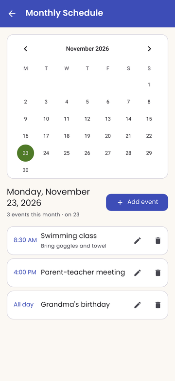
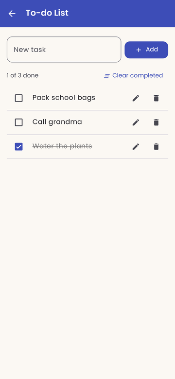
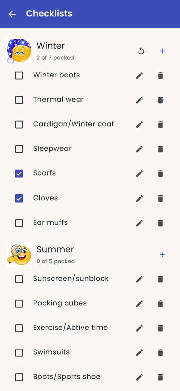
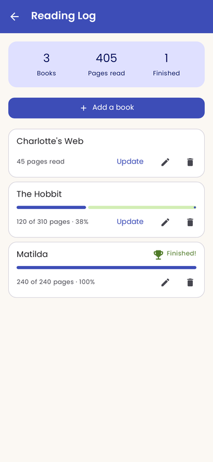

# FamilyApp

FamilyApp is an Android app that helps a family organise everyday life in one place: schedules, meals, chores, healthy habits, to-dos, checklists, reading and drawing.

It is written in Java with XML layouts, works fully offline, needs no account, and uses only free, open-source components.

<p>
  
  
  
  
</p>
<p>
  
  
  

</p>

## Features

| Feature | Screen | What it does |
|---|---|---|
| **Home** | `MainActivity` | Today summary (events, tasks, chores, habits, lunch, running timer) and six areas: Daily Life, Family Planner, Smart Checklists, Hobbies & Business, Family Hub, Learning Hub. |
| **Chores** | `ChoresActivity` | Household jobs for each family member, repeating daily/weekly/monthly, optional reminder, "do it tomorrow", and encouraging stars for the week. |
| **Healthy Habits** | `HabitsActivity` | Daily habits (water, outdoor play, reading, bedtime…) ticked off each day, with a 7-day progress row. |
| **Monthly Schedule** | `viewCalendar` | Family calendar: events with time, notes and who they're for; "Also add to phone calendar" on each event. |
| **Meal Planner** | `MealPlanner` | Spin the wheel or pick today's lunch from the family's own menu (2–16 foods). |
| **Timer** | `FamAppTimer` | Get Ready, Screen Time and Clean Up timers with editable lengths and an optional gentle chime. |
| **To-do List** | `ToDoList` | Tasks with who they're for; ticked tasks stay until cleared. |
| **Checklists** | `CheckList` | Winter, Summer, First-Aid Kit and your own lists, with an "Add new item" field in each. |
| **Creative Whiteboard** | `whiteboard/` | Draw with pencils, brushes, an eraser, lines, rectangles, circles and stars in 13 colours; undo and redo; starter scenes (garden, nature, space, roads); save, reopen, rename, duplicate, delete and save to the Gallery. |
| **Kids Activities** | `ActivitiesFun` | Random indoor and outdoor activity ideas. |
| **Reading Log** | `Reading` | Books, pages read and progress. |
| **Family Members** | `FamilyMembersActivity` | Names or nicknames, an avatar and a role; archive or delete without losing anyone's items. |
| **Settings** | `SettingsActivity` | Reminder alerts, alert time, lock-screen privacy, timer alerts and gentle sounds. |
| **Contact Us / About** | `ContactUs`, `AboutActivity` | Message form via the phone's email app; branding, version, privacy and credits. |

### Design

- One font throughout (Poppins, bundled so it works offline) and one colour palette, with a dark mode.
- Shared styles for headings, buttons, cards, text fields and spacing.
- Every screen has a title bar with a Back arrow.
- Layouts for phones and tablets, in portrait and landscape.

## Your data

Everything the family enters stays on the phone and works without internet:

| What | Where it is kept |
|---|---|
| Schedule events, to-do tasks, checklist items, food menu, daily lunch picks, books, family members, reminders, chores, habits and their history, drawing names | Room (SQLite) database `family.db` |
| Whiteboard drawings (editable strokes and shapes) and their previews | App-private files in `files/drawings/` |
| Timer lengths and the running timer | SharedPreferences |
| Unsent Contact Us message | SharedPreferences |

Rules the app follows:

- Nothing is deleted automatically. Deleting always asks first, and Cancel keeps the item.
- Default checklists and the food menu are added once, for first-time users, and never re-added over your changes.
- Data saved by version 1.1 (SharedPreferences) is copied into the database once on the first launch after updating. The old copy is kept as a backup.
- The database has no "destructive migration": a future version that changes the database must include a migration. The schema is exported to `app/schemas/`.
- Deleting a drawing removes only FamilyApp's copy. Pictures already saved to the Gallery stay.

## Contact details

The original app had no email address or phone number, so none are shown. To show them, fill in these two lines in `app/src/main/res/values/strings.xml`:

```xml
<string name="contact_email_address" translatable="false">you@example.com</string>
<string name="contact_phone_number" translatable="false">+1 555 0100</string>
```

When set, tapping them opens the email or phone app, and the message form addresses emails there. When left empty, the form still opens the email app and the person chooses the recipient.

## Tech stack

- **Language:** Java 17, XML layouts
- **UI:** Material Components 3, RecyclerView, CalendarView, custom `FoodWheelView`
- **Storage:** Room 2.6 (SQLite), SharedPreferences, app-private files
- **Whiteboard:** custom drawing view; editable JSON drawing files; `MediaStore` for Save to Gallery (Android 10+)
- **Reminders:** WorkManager, local notifications, AlarmManager for the Timer
- **Libraries:** AndroidX AppCompat, Activity, Core Splashscreen, Material Components, ConstraintLayout, RecyclerView, Room, Lifecycle, WorkManager (all free and open source)
- **Build:** Gradle 8.14.3, Android Gradle Plugin 8.7.3
- **SDK:** minimum Android 5.0 (API 21), target and compile Android 15 (API 35)
- **Permissions:** notifications (asked only when alerts are turned on), exact alarms for the Timer (optional), and restoring the Timer alarm after a restart. No camera, storage, contacts, location or internet permission.
- **Tests:** Robolectric

## Project structure

```
FamilyApp/
├── app/
│   ├── build.gradle
│   ├── schemas/                            # Database versions (for safe upgrades)
│   └── src/
│       ├── main/
│       │   ├── AndroidManifest.xml
│       │   ├── java/com/shajitha/familyapp/
│       │   │   ├── MainActivity.java       # Home screen
│       │   │   ├── BaseActivity.java       # Title bar with Back arrow for every screen
│       │   │   ├── viewCalendar.java       # Monthly Schedule
│       │       │   │   ├── MealPlanner.java        # Lunch wheel and food menu
│       │   │   ├── FoodWheelView.java      # The wheel, drawn in code
│       │   │   ├── FamAppTimer.java        # Routine timers
│       │   │   ├── ToDoList.java           # To-do list
│       │   │   ├── CheckList.java          # Checklists
│       │   │   ├── ChoresActivity.java     # Chores
│       │   │   ├── HabitsActivity.java     # Healthy habits
│       │   │   ├── RoutineEditor.java      # Add/edit dialog for chores and habits
│       │   │   ├── whiteboard/             # Creative Whiteboard: model, canvas, templates, files, screens
│       │   │   ├── reminders/              # Reminder engine, notifications, sounds, timer alarm
│       │   │   ├── ActivitiesFun.java      # Kids' activity ideas
│       │   │   ├── Reading.java            # Reading log
│       │   │   ├── ContactUs.java          # Contact form and credits
│       │   │   ├── Dialogs.java            # Shared edit and delete-confirmation dialogs
│       │   │   ├── FamilyStore.java        # Version 1.1 storage (read once, to copy into the database)
│       │   │   └── data/                   # Room database: tables, queries, first-run setup
│       │   ├── assets/licenses/            # Font licence
│       │   └── res/
│       │       ├── layout/  layout-land/   # Portrait and landscape screens
│       │       ├── values/                 # Strings, colours, themes, styles, spacing
│       │       ├── values-night/           # Dark mode colours
│       │       ├── values-sw600dp/ ...     # Tablet spacing
│       │       ├── drawable/               # Icons (Material Icons)
│       │       ├── drawable-nodpi/         # Pictures (never rescaled)
│       │       └── font/                   # Poppins
│       └── test/                           # Robolectric tests
├── docs/screenshots/
├── build.gradle
├── settings.gradle
└── gradle/wrapper/
```

## Getting started

1. Clone the repository:
   ```bash
   git clone https://github.com/ShajiHub/FamilyApp.git
   ```
2. Open the `FamilyApp` folder in Android Studio (Ladybug 2024.2 or newer).
3. If sync fails with "Incompatible Gradle JVM version", go to **Settings → Build, Execution, Deployment → Build Tools → Gradle** and set **Gradle JDK** to a Java 17 or 21 JDK (use **Download JDK…** if none is listed).
4. Run the `app` configuration on an emulator or device with Android 5.0 or later.

## Running the tests

```bash
./gradlew testDebugUnitTest
```

In Android Studio, right-click `app/src/test` and choose **Run 'Tests in test'**.

| Test class | What it checks |
|---|---|
| `ScreensTest` | Every screen: adding, editing, deleting (with Cancel), data kept after closing and reopening, rotation, landscape, small phone and tablet sizes, the timer's saved state, the meal wheel with 2, 3, 8 and 9 foods |
| `DataStorageTest` | Default lists, copying data from version 1.1 exactly once, user changes never overwritten, data kept after a restart |
| `ContactTest` | Contact form validation, the email app and the saved draft |
| `ChoresHabitsTest` | Chores (repeat, history, stars, filter), habits (check-ins, 7-day progress) and the Home summary |
| `WhiteboardTest` | Drawing format, undo/redo, damaged files, saving and reopening, rotation, rename, duplicate, delete, Gallery export |
| `ReminderSchedulingTest`, `RecurrenceTest`, `DatabaseMigrationTest`, `FamilyMembersTest`, `SettingsTest`, `SecurityTest` | Reminders and notifications, repeat dates, database upgrades and backups, family members, settings, security and privacy |
| `ScreenshotTest` | Draws every screen to `app/build/screenshots/` in portrait, landscape, dark mode and on a small phone |

These tests run on a simulated phone. Notifications, alarms, the email app, the calendar app, the Gallery and sounds are replaced by stand-ins, so they also need checking on a real device or emulator.

## Roadmap

Ideas for future versions:

- Family member profiles and tasks assigned to each person
- Chore chart with points and rewards
- Reminders and notifications for to-dos, events and finished timers
- Backup and restore of family data
- Shared family sync across phones

## Credits

- Font: [Poppins](https://github.com/itfoundry/Poppins), SIL Open Font License 1.1
- Icons: [Material Icons](https://github.com/google/material-design-icons), Apache License 2.0

## Author

Developed by [ShajiHub](https://github.com/ShajiHub).
