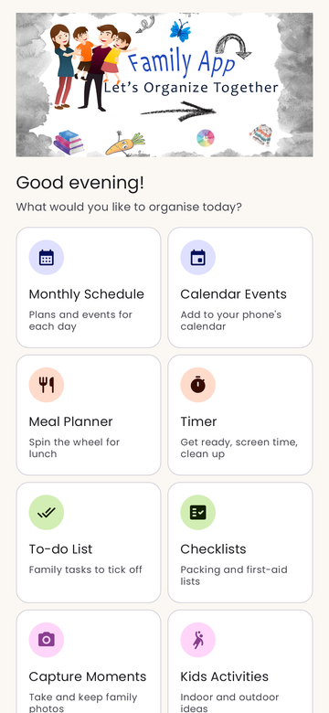
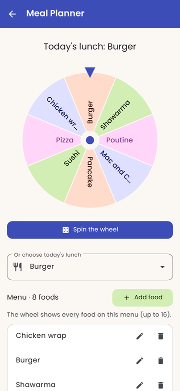
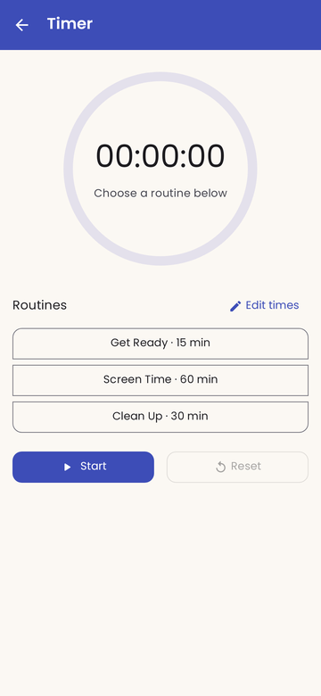
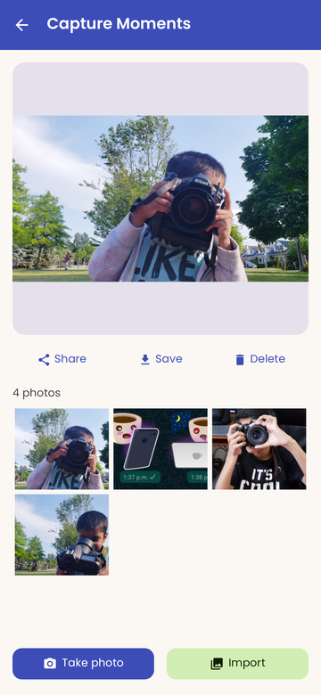

# FamilyApp

FamilyApp is an Android app that helps a family organise everyday life in one place: schedules, meals, routines, to-dos, checklists, reading and photos.

It is written in Java with XML layouts, works fully offline, needs no account, and uses only free, open-source components.

<p>
  
  
  
  
</p>
<p>
  
  
  
  
</p>

## Features

| Feature | Screen | What it does |
|---|---|---|
| **Monthly Schedule** | `viewCalendar` | Pick a day and add events with a title, optional time and notes. Edit or delete them; see which days of the month have events. |
| **Calendar Events** | `AddEvents` | Shows today's date and opens the phone's calendar app with a new one-hour event ready to fill in. |
| **Meal Planner** | `MealPlanner` | Spin the wheel to pick today's school lunch, or choose it from a dropdown. The family's own menu: add, rename and delete foods (2–16); the wheel always shows the current menu and lands on the food it announces. |
| **Timer** | `FamAppTimer` | Countdown timers for **Get Ready**, **Screen Time** and **Clean Up**, with editable lengths. Start, Pause, Resume and Reset; plays a sound when time is up. Keeps time after rotating the phone or closing the app. |
| **To-do List** | `ToDoList` | Add, edit, tick off and delete tasks. Ticked tasks stay until you clear them. |
| **Checklists** | `CheckList` | Winter, Summer and First-Aid Kit lists, plus your own. Add, edit, tick and delete items; untick a whole list. |
| **Capture Moments** | `PhotoGallery` | Take full-size photos with the camera, import photos from the phone, and view, share, save to the phone's gallery or delete them. |
| **Kids Activities** | `ActivitiesFun` | Random indoor and outdoor activity ideas. |
| **Reading Log** | `Reading` | Books with pages read, total pages, progress bar, "Finished!" badge and family totals. |
| **Contact Us** | `ContactUs` | Contact details (when set), a message form that opens the phone's email app, and the credits. |

### Design

- One font throughout (Poppins, bundled so it works offline) and one colour palette, with a dark mode.
- Shared styles for headings, buttons, cards, text fields and spacing.
- Every screen has a title bar with a Back arrow.
- Layouts for phones and tablets, in portrait and landscape.

## Your data

Everything the family enters stays on the phone and works without internet:

| What | Where it is kept |
|---|---|
| Schedule events, to-do tasks, checklist items, food menu, daily lunch picks, books | Room (SQLite) database `family.db` |
| Timer lengths and the running timer | SharedPreferences |
| Unsent Contact Us message | SharedPreferences |
| Photos (taken or imported) | The app's private Pictures folder |

Rules the app follows:

- Nothing is deleted automatically. Deleting always asks first, and Cancel keeps the item.
- Default checklists and the food menu are added once, for first-time users, and never re-added over your changes.
- Data saved by version 1.1 (SharedPreferences) is copied into the database once on the first launch after updating. The old copy is kept as a backup.
- The database has no "destructive migration": a future version that changes the database must include a migration. The schema is exported to `app/schemas/`.
- Deleting a photo removes only the app's copy. Copies saved to the phone's gallery stay.

## Contact details

The original app had no email address or phone number, so none are shown. To show them, fill in these two lines in `app/src/main/res/values/strings.xml`:

```xml
<string name="contact_email_address" translatable="false">you@example.com</string>
<string name="contact_phone_number" translatable="false">+1 555 0100</string>
```

When set, tapping them opens the email or phone app, and the message form addresses emails there. When left empty, the form still opens the email app and the person chooses the recipient.

## Tech stack

- **Language:** Java 17, XML layouts
- **UI:** Material Components 3, RecyclerView, CalendarView, custom `FoodWheelView`
- **Storage:** Room 2.6 (SQLite), SharedPreferences, app-private files
- **Photos:** camera app via `FileProvider`, Android Photo Picker, `MediaStore` for saving to the gallery
- **Libraries:** AndroidX AppCompat 1.7, Activity 1.9, Material 1.12, ConstraintLayout 2.2, RecyclerView 1.3, Room 2.6, Lifecycle LiveData 2.6, ExifInterface 1.3 (all free and open source)
- **Build:** Gradle 8.11.1, Android Gradle Plugin 8.7.3
- **SDK:** minimum Android 5.0 (API 21), target and compile Android 15 (API 35)
- **Permissions:** only `WRITE_EXTERNAL_STORAGE` on Android 9 and older, for "Save to gallery". Camera, calendar, email and the Photo Picker are used through their own apps.
- **Tests:** Robolectric

## Project structure

```
FamilyApp/
├── app/
│   ├── build.gradle
│   ├── schemas/                            # Database versions (for safe upgrades)
│   └── src/
│       ├── main/
│       │   ├── AndroidManifest.xml
│       │   ├── java/com/shajitha/familyapp/
│       │   │   ├── MainActivity.java       # Home screen
│       │   │   ├── BaseActivity.java       # Title bar with Back arrow for every screen
│       │   │   ├── viewCalendar.java       # Monthly Schedule
│       │   │   ├── AddEvents.java          # Add an event to the phone's calendar
│       │   │   ├── MealPlanner.java        # Lunch wheel and food menu
│       │   │   ├── FoodWheelView.java      # The wheel, drawn in code
│       │   │   ├── FamAppTimer.java        # Routine timers
│       │   │   ├── ToDoList.java           # To-do list
│       │   │   ├── CheckList.java          # Checklists
│       │   │   ├── PhotoGallery.java       # Capture Moments
│       │   │   ├── PhotoStore.java         # Photo files: list, import, save to gallery
│       │   │   ├── ActivitiesFun.java      # Kids' activity ideas
│       │   │   ├── Reading.java            # Reading log
│       │   │   ├── ContactUs.java          # Contact form and credits
│       │   │   ├── Dialogs.java            # Shared edit and delete-confirmation dialogs
│       │   │   ├── FamilyStore.java        # Version 1.1 storage (read once, to copy into the database)
│       │   │   └── data/                   # Room database: tables, queries, first-run setup
│       │   ├── assets/licenses/            # Font licence
│       │   └── res/
│       │       ├── layout/  layout-land/   # Portrait and landscape screens
│       │       ├── values/                 # Strings, colours, themes, styles, spacing
│       │       ├── values-night/           # Dark mode colours
│       │       ├── values-sw600dp/ ...     # Tablet spacing
│       │       ├── drawable/               # Icons (Material Icons)
│       │       ├── drawable-nodpi/         # Pictures (never rescaled)
│       │       └── font/                   # Poppins
│       └── test/                           # Robolectric tests
├── docs/screenshots/
├── build.gradle
├── settings.gradle
└── gradle/wrapper/
```

## Getting started

1. Clone the repository:
   ```bash
   git clone https://github.com/ShajiHub/FamilyApp.git
   ```
2. Open the `FamilyApp` folder in Android Studio (Ladybug 2024.2 or newer).
3. If sync fails with "Incompatible Gradle JVM version", go to **Settings → Build, Execution, Deployment → Build Tools → Gradle** and set **Gradle JDK** to a Java 17 or 21 JDK (use **Download JDK…** if none is listed).
4. Run the `app` configuration on an emulator or device with Android 5.0 or later.

## Running the tests

```bash
./gradlew testDebugUnitTest
```

In Android Studio, right-click `app/src/test` and choose **Run 'Tests in test'**.

| Test class | What it checks |
|---|---|
| `ScreensTest` | Every screen: adding, editing, deleting (with Cancel), data kept after closing and reopening, rotation, landscape, small phone and tablet sizes, the timer's saved state, the meal wheel with 2, 3, 8 and 9 foods |
| `DataStorageTest` | Default lists, copying data from version 1.1 exactly once, user changes never overwritten, data kept after a restart |
| `PhotoAndContactTest` | Camera cancel and capture, photo import, share, delete confirmation, contact form validation and the email app |
| `ScreenshotTest` | Draws every screen to `app/build/screenshots/` in portrait, landscape, dark mode and on a small phone |

These tests run on a simulated phone. The camera, Photo Picker, share sheet, email app, calendar app and notification sound are replaced by stand-ins, so they also need checking on a real device or emulator.

## Roadmap

Ideas for future versions:

- Family member profiles and tasks assigned to each person
- Chore chart with points and rewards
- Reminders and notifications for to-dos, events and finished timers
- Backup and restore of family data
- Shared family sync across phones

## Credits

- Font: [Poppins](https://github.com/itfoundry/Poppins), SIL Open Font License 1.1
- Icons: [Material Icons](https://github.com/google/material-design-icons), Apache License 2.0

## Author

Developed by [ShajiHub](https://github.com/ShajiHub).
